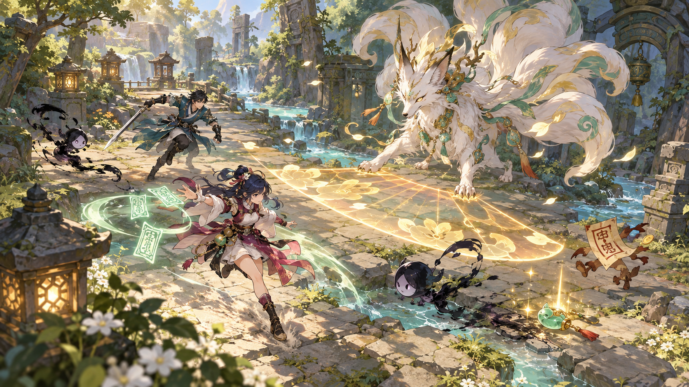

# 《山海異境》完整遊戲企劃 v2
## Re:縱橫鼎業｜神話戰鬥、角色養成與個人收藏博物館

日期：2026-10-29  
文件性質：完整產品與製作規格。數值是首輪試玩的起始方案，須經實際操作調整。  
交付狀態：本文件與既有美術概念已完成；下列新戰鬥、掉寶、展櫃與資料介面尚待實作，未因撰寫本文件而上線。

> 玩家以自己的動漫角色穿越山海異境，靠觀察、走位與招式擊敗神話對手，把每次冒險取得的卡片、器物與首領紀念物帶回自己的博物館。

概念圖沿用第一版「青丘林地」，供人物比例、色調、場景與戰鬥可讀性參考；並非執行中的 Godot 畫面。



## 1. 遊戲定位與設計原則

### 1.1 玩家應該感受到什麼

這是一款適合電腦與手機瀏覽器的東方幻想動作 RPG。美術採日系動漫人物、暖色手繪場景與有辨識度的怪物；戰鬥有貼近敵人的緊張、成功閃避的成就、掉寶的期待，以及把收藏擺進館內的滿足。

參考方向取《天堂》系列的角色養成、裝備輪廓與冒險張力，以及《仙境傳說》的明亮氣質、職業辨識與親切怪物。角色、道具、怪物、建築、介面與音樂均建立本專案自己的設計。

### 1.2 三個入口的分工

| 入口 | 玩家目的 | 核心操作 | 成果 |
|---|---|---|---|
| 國文劇本 | 閱讀、體驗文本、完成各課專屬挑戰 | 各篇原有的動作、策略、校勘與其他玩法 | 閱讀成果、證據判讀、課程進度 |
| 神話征討：《山海異境》 | 探索、戰鬥、掉寶與養成 | 移動、攻擊、技能、閃避、互動 | 裝備、材料、異獸卡、首領紀念物 |
| 我的博物館 | 欣賞與布置自己取得的收藏 | 找缺件、旋轉展品、換展位、組套組 | 個人展覽、收藏里程碑、展示主題 |

三者共用既有帳號、原創角色外觀與收藏帳本。首頁保留直接進入課程的路徑，學生不必先走村莊才能上課。

博物館以收藏為主。進門先看自己的代表藏品、最近入藏與收藏目標；課文來源在展品詳情中查看。Godot 村莊逐步成為神話冒險的整裝據點。

### 1.3 五項設計原則

1. **操作有因果**：看懂招式、選擇位置、使用環境，會實際改變戰果。
2. **區域有差異**：每區至少一項核心機制，足以改變玩家的打法。
3. **蒐藏看得見**：卡片、器物、雕像、外觀都能在館內或角色身上呈現。
4. **閱讀有位置**：原典與證據放在出發情報、探索觀察、圖鑑與戰後討論；即時戰鬥維持連續。
5. **成績有意義**：閱讀表現、戰鬥熟練與收藏完成度各自記錄，不互相冒充。

### 1.4 完整藍圖與首版邊界

完整遊戲藍圖包含六個區域、四種武器流派、六場大型首領或守護者試煉，以及分批擴充的收藏館。規劃上限先以約 24～30 種普通怪／精英、72 件收藏為內容管理目標，後續按品質增加。

首個可玩版本只完成一個完整循環：**青丘林地＋劍士與符師＋兩種普通怪＋一種精英＋九尾狐＋12 件收藏＋六個展位**。驗證戰鬥與收藏都成立，再增加區域。

## 2. 世界觀、主線與冒險據點

### 2.1 世界觀

「問鼎書院」保存許多文本與圖卷。一次「墨潮」使圖卷中的形象與記憶散入異境：有些化成尋常小妖，有些擾動山川，有些神獸則以試煉守住殘卷。

玩家是「守卷者」。任務是找回散落的記憶，修復圖卷與展藏。神話人物保留各自文化來源；墨潮、守卷者、區域連接與收復主線是遊戲原創設定。

並非每隻神獸都是邪惡敵人。九尾狐與其他對手可因誤解、失控或試煉與玩家交手；勝利可能表現為驅散墨障、完成考驗、恢復平靜。一般戰鬥以明確的受擊與消散效果呈現。

### 2.2 主線章節

| 章 | 區域 | 主線事件 | 核心變化 |
|---|---|---|---|
| 序 | 問鼎書院 | 學會移動、整裝、出戰與入藏 | 建立角色與第一個展位 |
| 一 | 青丘林地 | 尋找流失的狐紋圖卷，面對九尾狐試煉 | 辨真偽、走位、引導狐火 |
| 二 | 章莪赤嶺 | 控制蔓延的異火，重啟山中的水渠 | 風向與地形改造 |
| 三 | 流波雷灣 | 穿越暴雨遺港，面對夔的雷潮 | 潮位、節奏、導雷 |
| 四 | 共工幽澤 | 打通水路，阻止相柳墨影擴散 | 多目標、淨地、資源分配 |
| 五 | 鍾山晝夜 | 接受燭陰守護者的晝夜考驗 | 光影切換、規則辨識 |
| 終 | 斷簡天闕 | 追上吞卷墨魘，修復核心圖卷 | 把前述機制重新組合 |

這是遊戲的旅行順序，不宣稱重建《山海經》的實際地理。

### 2.3 據點配置

據點保持小而易懂，從入口到出戰牌的步行時間以約 15 秒為設計目標，並提供直接開啟功能的按鈕。

- **出戰牌**：選區域、難度、收藏目標與練習模式。
- **整裝臺**：武器、裝備、造型、同行能力與訓練木樁。
- **工匠亭**：製作與升級，直接顯示材料缺口。
- **藏品接待臺**：最近入藏、未收藏物與展位布置。
- **圖卷案**：神話來源、區域情報、課文連結與支線紀錄。
- **返程點**：回課程首頁或回上一頁。

據點 NPC 首版以三位原創角色集中承擔：掌卷人「簡衡」、工匠「阿硯」、藏品整理員「小篆」。對話可略過、可重讀；名字與造型在製作角色稿時定案。

## 3. 從首次登入到第一件收藏

### 3.1 第一次進入的十五分鐘

| 時間目標 | 玩家所做的事 | 引導與回饋 |
|---|---|---|
| 0～2 分鐘 | 沿用／建立角色，選劍或符 | 預覽招式；能在出發前改選 |
| 2～4 分鐘 | 據點練習移動、攻擊、閃避 | 一次只教一個動作；成功後提示退場 |
| 4～6 分鐘 | 在林口迎戰墨團精 | 怪物前搖明顯；獲得第一張卡 |
| 6～9 分鐘 | 選溪畔路線、處理符陣、遇精英 | 小目標與環境提示，不逐步代打 |
| 9～13 分鐘 | 完成石燈教學與九尾狐試煉 | 先安全示範一次，再進完整戰鬥 |
| 13～15 分鐘 | 結算、回館、擺上狐紋玉墜 | 鏡頭拉近新展品，顯示下一件收藏線索 |

首次進入含教學約 12～18 分鐘；熟悉後一趟青丘約 8～12 分鐘。這是關卡節奏目標，不是強制倒數。

### 3.2 引導方式

提示採三層，玩家可自行開啟或關閉。

- **初見提示**：第一次遇見該機制，簡短顯示「把狐火引到石燈旁」。
- **受挫提示**：同一機制連續失誤後，提供更具體的觀察方向。
- **按需提示**：暫停頁可看控制示意與該敵人已發現的情報。

危險招式透過地面形狀、動作與聲音共同表達。劇情說明可跳過，重新查看不扣成績。新手引導獎勵每帳號只發一次，避免反覆重設領取。

### 3.3 第一次失敗

倒地後顯示「最常受擊的招式」與一條可操作建議，例如「尾掃出現扇形時，向狐身側後方移動」。可從首領門口重試，不必把整張地圖重新清空。

普通素材只保留已在檢查點確認的部分。首領獎勵以完成整場試煉為條件。介面事先說明哪些已存、哪些待結算。

## 4. 角色、造型、配點與職業

### 4.1 一人一角與完整造型

沿用原帳號的一位角色。男、女基底都採日系動漫比例，約 5.5～6 頭身；相同職業有同等完整的動作與裝備支援。

首版接續現有身形、服裝、配色、膚色與髮色欄位。後續逐步加入髮型、臉型、眼型、披肩、武器外觀與飾品；新增欄位均有預設值與遷移規則。

所有職業開放男女角色使用。服裝沿用同一主題並按骨架與身形調整版型，避免以性別限制職業、裝備能力或收藏取得。

「裝備能力」與「顯示外觀」分開：玩家換上較強裝備時，仍可保留喜歡的衣服。武器外觀須維持當前武器類別，讓攻擊範圍仍能被理解。

### 4.2 現有配點如何延用

本機程式確認：既有角色是 **六項屬性，各 0～4 點，總計 12 點；八項能力中裝備兩項**。先沿用這套結構，不直接增加總點數。

課程配點與神話配點使用同一個角色身分、各自的設定頁。第一次可複製目前配點；在據點免費調整神話配置，進副本後鎖定本局快照。變更神話配置不會改動既有劇本效果。

| 屬性 | 神話戰鬥用途 | 平衡原則 |
|---|---|---|
| 身法 | 移動、閃避後的位移控制 | 改善手感，無法穿越地形 |
| 臂力 | 近戰傷害、破甲累積 | 幅度有限，不形成唯一解 |
| 巧手 | 蓄力、精準命中與回收動作 | 不改變固定物理步長 |
| 定力 | 護盾、施法穩定與受擊恢復 | 仍須主動避開大招 |
| 察勢 | 看見觀察線索與較早辨識預警 | 所有人都有基本可讀預警 |
| 籌算 | 陷阱、支援符陣與道具效率 | 不自動解題或免除關卡機制 |

起始調校可採每點約 2～3% 的局部差異；資訊提示則用小幅時間差或更清楚的圖示。完整可玩與無障礙提示不以配點解鎖。

### 4.3 職業由武器決定

| 流派 | 戰鬥特徵 | 三個核心技能 | 主要代價 | 製作階段 |
|---|---|---|---|---|
| 劍士 | 近身連段、格擋、破甲 | 折鋒突進／守勢反擊／迴風斬 | 需要貼近、管理收招 | 首版 |
| 符師 | 遠程符彈、封印、護盾 | 鎖靈符／護身紙陣／落印破陣 | 施法前搖、精力使用 | 首版 |
| 弓手 | 邊走邊射、蓄力、穿透 | 踏風射／穿林箭／絆足陷阱 | 被貼身時不利 | 擴充 |
| 機巧師 | 架設器具、引導、區域支援 | 引雷樁／牽絲偶／機關連發 | 佈署位置與回收時機 | 擴充 |

一位角色可以在據點換武器。首版不要求重練不同角色，也不以長期單調刷怪作為換職業門檻。職業熟練主要解鎖招式變體與外觀。

### 4.4 劍士與符師的首版招式

下列秒數均為原型值。

| 招式 | 功能 | 起始代價／冷卻 | 可讀回饋 |
|---|---|---|---|
| 劍士普通三連 | 前兩段快，第三段破擊 | 第三段收招較長 | 劍弧小、命中短停頓 |
| 折鋒突進 | 短距離接近並打斷可打斷攻擊 | 精力 15／6 秒 | 直線軌跡，終點明確 |
| 守勢反擊 | 短時格擋；時機成功可追擊 | 精力 12／8 秒 | 武器亮紋與清脆音 |
| 迴風斬 | 處理近身群怪與分裂小妖 | 精力 25／10 秒 | 範圍環清楚，外圍不命中 |
| 符師普通符彈 | 有飛行時間的中距離攻擊 | 可連發，移動時速度稍降 | 符彈與命中點可辨 |
| 鎖靈符 | 短暫限制小怪移動，對首領累積破綻 | 精力 15／7 秒 | 地面符圈與剩餘時間 |
| 護身紙陣 | 提供短時護盾，容許重新站位 | 精力 18／10 秒 | 透明輪廓，不遮危險區 |
| 落印破陣 | 蓄力範圍攻擊，可提前釋放 | 精力 25／10 秒 | 讀條與範圍預覽 |

首領不被永久控住；控場對首領轉成「破綻累積」。任何流派都有完成場景機制的能力。

### 4.5 八項同行能力的神話版本

兩項能力可改變原有動作，避免手機額外堆出八顆按鈕。需要主動施放的能力佔用一個既有技能槽，出發前顯示替換結果。

| 能力 | 神話效果 | 代價／觸發 |
|---|---|---|
| 迅影 | 閃避距離較長，結束後短暫加速 | 閃避耗精力提高 |
| 握定 | 改善格擋或護盾的穩定性 | 生效期間移動較慢 |
| 巧勁 | 蓄力技較能集中破綻傷害 | 必須完成較長準備 |
| 望勢 | 更早出現下一招的方向線索 | 無直接傷害加成 |
| 聽息 | 停步觀察時較快辨別真身腳步 | 有等效視覺提示 |
| 輕裝 | 移動加快 | 精力上限降低 |
| 運籌 | 技能槽可選支援符陣 | 每次佈署有冷卻與精力代價 |
| 留痕 | 技能槽可選短距離撤退標記 | 只回到可達安全點，不穿牆、不越階段 |

同一能力在國文劇本中的原有效果保留。戰鬥版另外標示效果、冷卻與版本。

## 5. 操作、鏡頭與戰鬥規則

### 5.1 多種控制方式

| 平臺 | 移動 | 攻擊與技能 | 鏡頭與互動 |
|---|---|---|---|
| 電腦點擊模式 | 點地面尋路，拖動可連續指定方向 | 點怪鎖定、滑鼠或自訂快捷鍵 | 拖曳空白處旋轉，滾輪縮放，互動鍵 |
| 電腦方向模式 | 方向鍵或 WASD，可重綁 | 攻擊、三技能與閃避可重綁 | 同上，另有回正視角 |
| 手機／平板 | 左側方向盤，可改浮動或固定 | 右側攻擊、三技能、閃避 | 空白區拖曳旋轉，雙指縮放；情境互動 |
| 手把（後續） | 左搖桿 | 按鍵施招與鎖定 | 右搖桿轉向 |

點擊怪物後可持續對目前目標普攻；移動、閃避或切換目標會打斷。自動普攻不替玩家躲招、不自行找下一群敵人，也不自動走完整張圖。

### 5.2 鏡頭

採可旋轉的斜俯視 3D 鏡頭。預設距離讓人物與敵人招式看得清楚，提供近、中、遠三段快捷縮放及連續縮放。

玩家可 360 度轉向。建築、石柱、主路與近景必須有完整立體結構；手繪貼圖附著在模型上。遠景可用簡化幾何或分區環景，不能讓旋轉後看見大片空白背面。

樹冠、屋簷與高牆遮住玩家時淡出。首領戰進場可短暫提示建議視角，交戰後不突然搶鏡頭。提供鎖定目標、自由鏡頭與一鍵回正。縮放範圍要同時容納操控與觀賞，近看收藏另用展示模式。

### 5.3 戰鬥狀態

角色至少包含：待機、移動、普通攻擊、技能準備、技能生效、收招、閃避、受擊、倒地、互動。每招明定準備期、命中期、可取消點與收招期。

- 輕攻擊可以接下一段；第三段收招較長，貪打會失去閃避時機。
- 一般技能準備可取消，但可能消耗部分代價；大招生效後遵守收招。
- 閃避消耗精力。精力不足時按鍵仍有「不足」回饋，不假裝有執行。
- 連續受擊有短暫保護，避免普通怪把玩家無限連到倒地。
- 傷害由明確碰撞／命中窗口產生；同一攻擊對同一目標不能每一格重複扣血。
- 暫停、鏡頭轉動與畫面 FPS 不改變攻擊速度或技能冷卻。

### 5.4 首輪數值基準

| 項目 | 原型起始值／目標 |
|---|---|
| 新手生命 | 600 |
| 精力 | 100 |
| 基礎移速 | 約 4.6 公尺／秒 |
| 閃避 | 約 0.45 秒，耗精力 24 |
| 精力恢復 | 停止消耗約 0.8 秒後，每秒恢復 18 |
| 一般小怪一次傷害 | 約 45～65 |
| 首領一般命中 | 約 90～120 |
| 普通小怪處理時間 | 約 3～6 秒 |
| 精英交戰 | 約 25～45 秒 |
| 熟悉後首領戰 | 約 2～4 分鐘 |

閃避有效保護窗初步設於動作中段約 0.18 秒，須配合動畫與延遲實測。顯示給玩家的重點是能否躲過招式；詳細數值只放進階說明。

### 5.5 難度

- **引導**：放慢部分招式、增加提示、首領機制仍完整；可取得基本收藏。
- **標準**：完整基本規則與一般掉落。
- **進階**：加入招式串接與額外目標，獎勵稱號、配色或雕像條件。
- **定式試煉**：固定裝備、規則與版本，用於個人挑戰及後續班級比較。

不同難度的紀錄分開。調整提示、字體、色彩與字幕不減少基本獎勵。

## 6. 青丘林地完整副本

### 6.1 關卡結構

林間入口 → 溪畔岔路 → 符紋遺跡 → 石燈庭 → 九尾狐場地。

首張地圖以約 160×120 公尺的分區場景為起始尺度，實際尺寸依走動與鏡頭測試調整。各區透過彎道、石橋與植被分隔，降低同時可見的物件量。

| 區段 | 目的 | 內容 | 記錄點 |
|---|---|---|---|
| 林間入口 | 教普通攻擊與閃避 | 兩小群墨團精、一個安全觀察點 | 第一張卡與操作教學 |
| 溪畔岔路 | 提供路線選擇 | 安全長路／符陣捷徑／支線小臺 | 路線與寶箱旗標 |
| 符紋遺跡 | 檢驗多敵人走位 | 墨團精、符紙妖的組合 | 區段完成 |
| 石燈庭 | 精英與首領機制預習 | 石甲猿妖、可引燃石燈 | 素材確認與首領檢查點 |
| 狐影環臺 | 三階段首領戰 | 九尾狐、石燈、可讀腳印 | 首通與戰利品收據 |

### 6.2 普通怪與精英

**墨團精：處理分裂的選擇。** 圓潤的墨滴身體、筆鋒耳朵與可見表情。短距離跳撲前會壓低身體並顯示落點。受到重擊時可分裂一次成兩隻小墨靈，每隻不再分裂；可用輕攻擊穩定處理，也可主動分裂後用範圍技快速清除。首版同屏總數有上限，分裂不形成無窮怪海。

**符紙妖：改變玩家路線。** 由折紙、符角與小燈芯構成。先在地面投影符紋，約一秒後引爆；符紋出現後位置固定，玩家可藉此預留安全路徑。連續施法後有明確停頓，近戰可接近、遠程可打斷。危險符陣有邊框與紋理，不只依靠紅色。

**石甲猿妖：利用衝撞。** 原創猿形精英，石片護肩與青苔背甲形成明確正面。先吼叫，再鎖定方向衝撞；玩家能移到石柱旁誘導，撞柱後護甲暫時鬆開。地圖至少有三根可用柱，破壞後會留下可用地形或定時恢復，避免資源耗盡後無法完成。未成功撞柱仍能從背側慢慢破甲。

### 6.3 岔路與支線

| 內容 | 選擇與挑戰 | 獎勵 |
|---|---|---|
| 溪橋長路 | 怪物較少，但路較遠 | 安定取得普通素材 |
| 符陣捷徑 | 躲過交錯地面符陣，可縮短路程 | 速度紀錄與隱藏箱機會 |
| 失落燈芯 | 找回三枚燈芯，其中一枚在精英側路 | 符紋燈收藏配方 |
| 溪畔照影 | 在可選觀察點辨識真正留下足跡的狐影 | 名場面收藏 |
| 不碎之柱 | 不依靠撞柱擊敗精英 | 進階徽記條件 |

隱藏物有環境線索，例如風鈴、足跡、反光或可閱讀的殘簡。收藏提示會指出大致區段，不要求玩家盲目點遍整張地圖。

### 6.4 九尾狐戰鬥

首領形象取自《山海經》青丘九尾狐；分身、狐火、護盾與石燈互動均為遊戲創作。[原典來源：〈南山經〉](https://zh.wikisource.org/wiki/山海經/南山經)。

首領生命原型值約 5,000，以 70% 與 35% 作階段轉換點。傷害與生命要由兩種首版職業都能合理通過的實測決定。

**第一階段：看見真身。**

九尾狐以扇形尾掃與短跳撲試探，之後放出兩個幻影。真身在溪水與地面留下穩定腳印；幻影的足跡短暫消散。玩家可以觀察、移動測試或用攻擊確認，誤擊幻影不立刻秒殺，只付出位置與時間代價。

第一輪幻影會安全示範一次。聽息、望勢可以加強線索，但未裝備也有完整視覺提示。此階段教玩家「先看，再攻擊」。

**第二階段：管理安全空間。**

首領交錯使用扇形尾掃、地面狐火與側向躍擊。狐火留下短暫危險區，但會按順序熄滅；每個招式組合必有可達安全路徑。場邊提供足夠迴旋空間，不以無預警關門夾死角色。

玩家需要決定繼續輸出、保留精力或繞到下一個安全區。普通難度避免同時出現辨真身、追蹤火與大範圍尾掃三種最高負荷。

**第三階段：引火破盾。**

九尾狐進入護盾狀態，場中亮起兩座待啟動石燈。追蹤狐火先標記玩家，再延遲追來；玩家走到燈旁，把火引入燈座後側移離開。兩燈啟動後護盾解除，出現約六秒的輸出窗口。

火接近燈座時出現清楚連線與音效，成功後燈色與符紋同時改變。失敗後狐火循環重來，石燈不會永久報廢。若窗口內未擊敗首領，進入下一輪，最多只增加招式節奏，不累積不可逆的滿場危險區。

### 6.5 首領招式契約

| 招式 | 預警 | 玩家回應 | 反擊機會 |
|---|---|---|---|
| 扇形尾掃 | 尾部抬高、地面扇形約 0.9 秒 | 往側後方走或閃避 | 尾掃結束短停 |
| 撲影 | 身體壓低、固定方向箭紋 | 側移，避免向直線後退 | 落地收招 |
| 幻影列 | 足跡與倒影差異 | 找真身或先保持距離 | 正確命中累積破綻 |
| 追蹤狐火 | 頭頂標記與地面指引 | 引至石燈後離開 | 兩燈完成後破盾 |
| 狐火環 | 地面分段亮紋 | 走向尚未亮起的缺口 | 招式結束回到中央 |

招式前搖以真實時間計算，與畫面幀率分離。練習場可單獨選一招反覆練習。

### 6.6 青丘首版收藏清單：12 件

| 藏品 | 類型 | 取得條件 | 是否保證 |
|---|---|---|---|
| 墨靈卡 | 異獸卡 | 首次完成墨團精區段 | 保證 |
| 符紙妖卡 | 異獸卡 | 首次完成符紋遺跡 | 保證 |
| 石甲猿妖卡 | 異獸卡 | 首次擊敗精英並結算 | 保證 |
| 狐靈卡 | 異獸卡 | 首次完成九尾狐試煉 | 保證 |
| 狐紋玉墜 | 立體器物 | 首次通關青丘 | 保證 |
| 符紋燈 | 立體器物 | 完成燈芯支線並製作 | 可確定取得 |
| 猿紋護腕複製品 | 展示器物 | 精英素材配方 | 可確定取得 |
| 林間遇墨 | 名場面 | 完成初見事件 | 保證 |
| 溪畔照影 | 名場面 | 完成可選觀察事件 | 保證 |
| 雙燈映狐 | 名場面 | 在同一次首領循環啟動兩燈 | 可確定取得 |
| 青丘九尾狐立像 | 首領雕像 | 標準首領額外掉落或 8 枚青丘印記兌換 | 有兌換路徑 |
| 守卷者・青丘旗 | 榮譽展示 | 集齊上述 11 件 | 保證 |

每件用獨立收藏鍵，重複取得不增加不同藏品數。狐紋玉墜、燈具、護腕複製品與雕像是本遊戲虛構展品，詳情中的「遊戲創作」說明保持清楚。


## 7. 區域、神話怪物與後續章節

### 7.1 六區的差異

| 區域 | 場景氣質 | 核心問題 | 特色行動 | 收藏主題 |
|---|---|---|---|---|
| 青丘林地 | 青綠密林、溪水、玉石與暖日 | 什麼是真的？何時該換位？ | 看足跡、引狐火、分流群怪 | 狐紋、石燈、墨靈 |
| 章莪赤嶺 | 赤岩、青鳥、火風與山渠 | 火勢將往哪裡走？ | 轉風幡、開水閘、改造安全路線 | 畢方羽紋、陶器、焦木 |
| 流波雷灣 | 雨港、海潮、藍白雷光 | 下一個安全節點在哪裡？ | 讀雷拍、避導電水面、佈導雷樁 | 雷鼓、潮汐盤、海港圖 |
| 共工幽澤 | 蘆葦、沉橋、青紫水霧 | 先處理哪個威脅？ | 開水道、分配淨地、選擇封頭次序 | 蛇紋、淨水器、浮島 |
| 鍾山晝夜 | 黑金山壁、日輪、月色回廊 | 目前是哪一套規則？ | 切換光影、觀察場景、記住安全結構 | 晝夜盤、守護者像、光影屏 |
| 斷簡天闕 | 空中書頁、墨海、斷裂樓閣 | 如何把已學機制連用？ | 選路、處理短事件、應對組合首領 | 修復圖卷、終章旗、冒險回顧 |

各區普通怪也服從本區特色。首版後每區先製作兩種新普通怪、一種精英與一場首領；追加怪物時才擴到完整藍圖的數量。

### 7.2 章莪赤嶺：風火改道

**神話核心：畢方。** 原典記述包含似鶴、一足及與火的關聯；風幡、水閘與戰鬥招式是本遊戲創作。[原典來源：〈西山經〉章莪之山段](https://zh.wikisource.org/wiki/山海經/西山經)。

路線是裂岩古道 → 山渠工坊 → 風幡臺 → 畢方棲臺。火勢沿可見風向擴散，玩家能在安全點轉動風幡，或開水閘建立短暫通道。

- **炭殼蟲**：背殼高防，泡水後容易破開；也能從腹側攻擊。
- **燼風靈**：沿風移動並留下火種，須提前截住或改變風向。
- **赤岩守衛**：持盾推進，用水流或場景落石打開破綻。
- **畢方首領**：翅風先推動火線，再俯衝。玩家利用風幡把火引往空地，開水閘保住補給區；最後依落羽線索判斷降落位置。

此關的挑戰是改變戰場。水閘不能一次開完；保持一條安全退路，比單純堆高傷害有效。

支線「未熄的窯」要求保護工坊三處窯火，讓玩家在滅災與保留火種之間選擇。支線展品是遊戲創作的「水火雙紋陶盞」。

### 7.3 流波雷灣：潮位與節奏

**神話核心：夔。** 原典包含牛形、一足、風雨與雷聲意象；導雷與節奏玩法為原創。[原典來源：〈大荒東經〉流波山段](https://zh.wikisource.org/wiki/山海經/大荒東經)。

路線是潮汐棧橋 → 雨中遺港 → 引雷石臺 → 雷潮場。潮位定時改變可走區域；導電區有水紋與圖示，不能只看顏色。

- **潮殼蟹妖**：借退潮露出的地面接近，漲潮時退守。
- **雷鱗魚靈**：沿帶電水線躍擊，可打斷蓄電。
- **遺港鐘衛**：敲鐘形成不同節奏的環狀波，需要抓準時機閃避或繞位。
- **夔首領**：踏地震波與雷落形成短節奏句；玩家把追蹤雷導入石樁，建立暫時安全區，再處理下個潮位。

節奏同時以地面擴張環、倒數亮點與聲音提示。關閉音效也能完整遊玩。不同節奏有先行練習，不以音樂知識為門檻。

支線「失去聲音的鼓」收集三段回聲，按觀察到的順序修復鼓臺。收藏包含遊戲製作的夔紋雷鼓，不把遊戲物件當作出土文物。

### 7.4 共工幽澤：多目標與資源管理

**神話核心：相柳。** 原典有九首、蛇身及澤地意象；此關呈現「相柳墨影」，淨水與戰鬥封印是原創。[原典來源：〈海外北經〉](https://zh.wikisource.org/wiki/山海經/海外北經)。

路線是蘆洲岔道 → 沉橋水門 → 淨地浮島 → 九首潭。玩家帶有限次淨地工具，能清出安全站位或恢復某條支路。普通攻擊仍可慢慢清除墨障，避免工具用完就卡關。

- **藻纏靈**：牽制路線，須打斷纏繞節點。
- **沼泡妖**：受擊後漂移，能被引到別處後再處理。
- **沉橋傀儡**：控制水門；選擇先打它或繞遠路。
- **相柳墨影首領**：不是九個頭同時亂射。每輪突出兩至三個不同職責的蛇首，例如噴霧、召喚、封路。玩家選擇先壓制哪個頭，改變接下來的安全空間。

重點是威脅排序、路線與有限工具。每輪都保留至少一條安全回復路，難度來自決策，而非用特效遮住畫面。

支線「可種之洲」需要在戰鬥中保住三處淨地；能取得一座可在館內呈現的「澤畔新苗」小景。

### 7.5 鍾山晝夜：觀察規則的守護者試煉

**神話核心：燭陰。** 原典以視為晝、瞑為夜等意象描寫；關卡切換、光橋與測試規則是原創。[原典來源：〈海外北經〉鍾山段](https://zh.wikisource.org/wiki/山海經/海外北經)。

守護者與玩家的關係是授予試煉。結尾是獲得認可，不以殺死神祇為劇情。

- 白晝可見實體地形，夜間顯出隱藏墨路；兩種形態的危險圖案有不同紋理。
- 玩家能在限定節點切換晝夜，保留上一狀態的短暫輪廓，減少純記憶負擔。
- 普通敵人有「日甲夜弱」或「夜行日眠」特徵，迫使換狀態與選時機。
- 守護者試煉交錯出現光束、影路與場景觀察，要求在移動中讀懂當前規則。
- 後段出現短暫雙相重疊，玩家要從兩層資訊找到共同安全區。

支線「影子的主人」讓玩家依物件影子找回遺失器物，形成觀察式收藏任務。

### 7.6 斷簡天闕：組合而不重複

終章對手「吞卷墨魘」為完全原創，不把它包裝成古籍神話。

每次選擇三段已熟悉的機制，但更換目標：狐火可用來啟動移動書頁上的燈；導雷能清掉阻路墨鎖；晝夜切換揭露下一座平臺。不是直接重打五個相同首領。

終章首領分為追蹤、破卷、修復三段。最終操作是讓失序的卷頁回到位置，完成後解鎖「守卷者總展」與旅程回顧。

## 8. 裝備、掉寶與經濟

### 8.1 裝備槽與成長

首版四槽：武器、衣甲、護符、印記。角色不因升級獲得額外的 12 點屬性；等級與職業熟練解鎖配方、招式變體與區域內容。

- **武器**：決定流派、攻擊範圍與招式。
- **衣甲**：提供基本生命或防護，兼顧造型。
- **護符**：提供明確取捨，例如護盾較厚但回復較慢。
- **印記**：改變特定招式，例如範圍較小、破綻傷害較高。

首版每件裝備最多升三級，材料與結果事先可見。升級不破壞裝備、不降級。第一個地區即可製作足以通關的裝備，首領也必須可用基礎裝備依靠操作完成。

### 8.2 掉落分層

| 類別 | 用途 | 玩家獲得感 |
|---|---|---|
| 普通素材 | 製作與升級 | 每次探索都有進展 |
| 配方與部件 | 製作特定物件 | 有清楚的收集目標 |
| 裝備與招式變體 | 改變流派與手感 | 嘗試新打法 |
| 怪物卡與器物 | 入館收藏 | 看得見的新發現 |
| 立像、配色與稱號 | 高挑戰紀念 | 展示個人達成 |

地上掉寶先顯示類型與輪廓，近距離可自動拾取普通材料。重要收藏用短暫翻卡或入藏動畫，可略過，不中斷危險中的操作。

伺服器核定後才列為永久取得；連線尚未完成時以「待確認」小圖示表示。

### 8.3 青丘原型掉落規則

- 首次完成對應區段：保證一張該怪物卡。
- 首次通關九尾狐：保證狐靈卡與狐紋玉墜。
- 標準首領每次完成：保證一枚青丘印記。
- 青丘九尾狐立像：原型機率 10%；也可用八枚青丘印記兌換。
- 已有立像再掉落：轉成對應材料，畫面先告知，不計成新收藏。
- 進階挑戰的首次額外獎勵以明確條件解鎖，不和低機率抽取混在一起。

具體機率、材料數量與兌換價在測試後定案，收藏詳情中可查看當前版本。獎勵池由伺服器按固定版本選擇，客戶端不能自行傳入要領的稀有物。

### 8.4 貨幣與材料

首版保留兩種主要進度資源：「靈砂」用於裝備製作與升級；「青丘印記」用於區域收藏兌換。一般材料維持少量種類，例如墨晶、符紙、燈芯與石甲片。

完整遊戲每區可有區域印記，但介面預設只展開當前區域，避免學生看到一長排難懂貨幣。材料不佔有限背包格，無須反覆清垃圾。

裝備暫存空間接近滿時先引導分解，禁止靜默丟棄新裝備。展品沒有持有格數限制，館內展位只決定擺什麼。

### 8.5 重玩的期待

進度同時顯示「還差幾份材料」「這次想拿的收藏」「下一個挑戰目標」。不要求每日登入領體力，也不靠長時間掛機維持進度。

交易市場、玩家掠奪、強制公會與現金抽取不列入本企劃。競技獎勵主要是榮譽與外觀，避免裝備差距壓過操作。

## 9. 博物館收藏與展示

### 9.1 進館第一眼

畫面先呈現三件事：自己的主展品、最近入藏、下一件想找的藏品。玩家能直接按「布置展位」「查看收藏」「前往取得」，也能自由走動欣賞。

原有課程人物、名場面與器物收藏繼續保留；既有收藏鍵不改名。神話館藏增加為新的來源，與課文史冊都可放進個人主展區。

### 9.2 收藏分類

| 分類 | 主要內容 | 展示方式 |
|---|---|---|
| 史冊 | 既有課文人物、名場面、相關器物 | 畫框、卷軸、人物卡 |
| 異獸 | 怪物卡、發現情報、招式紀錄 | 卡冊、原畫、可旋轉模型 |
| 器物 | 戰利品、工藝、虛構複製品 | 展臺、近看、材質與細節 |
| 榮譽 | 首領立像、旗幟、稱號、里程碑 | 雕像、旗座、主題展景 |

「原典記述」「遊戲設定」「取得紀錄」在詳情分成清楚的小區塊。主畫面不塞滿說明文字，想了解時再展開。

### 9.3 六個首版展位

首版主展室六個展位，每個展位支援卡片、名場面或立體物件的對應展具。玩家選位置、挑藏品、看預覽、確認後保存；可一次交換兩個展位。

後續擴充 18／36 展位採加開展室，不把單一場景無限塞滿。每間展室按需載入模型，遠處以小圖或簡化模型預覽。

展位只引用已取得收藏鍵，不在展位資料內複製整個物件。移除展品只讓展位空出，收藏仍在帳本。

### 9.4 缺件、套組與目標

- 未取得：顯示剪影、區域、明確條件與已累積進度。
- 已取得：顯示首次取得日期、來源、可展示類型與是否已擺放。
- 套組：列出缺件，可把其中一件設成出戰追蹤目標。
- 重複物：顯示累積數或轉換材料，不灌高不同收藏數。
- 搜尋：篇名、怪物、物件、區域均能找得到。
- 篩選：最近取得、尚未取得、已展示、可兌換、課程來源。

收藏套組優先解鎖展館主題、配色、旗幟、故事與角色外觀。完成課文套組也能有獨立展示價值，不要求先打首領。

### 9.5 展示與分享

首版提供乾淨的「拍照模式」：隱藏操作介面、調整鏡頭、顯示自訂館名與選配的角色暱稱。下載前預覽，預設不顯示學號、Email 或班級。

後續分享展館採明確的「建立分享」動作，產生只能看展品配置的快照。一般同學無法透過展示頁查詢對方成績、背包、帳號或未分享紀錄。取消分享後停止外部讀取。

首版不開放任意上傳圖片與模型，以維持載入速度及展示內容的一致性。

## 10. 任務、重玩與競技

### 10.1 任務類型

1. **主線任務**：推進區域與世界觀。
2. **探索任務**：找路、觀察、收集場景線索。
3. **機制任務**：用環境達成特殊目標，例如保住水渠。
4. **收藏任務**：追蹤一件展品或完成一套主題。
5. **熟練任務**：改進閃避、格擋、弱點命中與機制成功率。
6. **課文連結任務**：閱讀後進行證據比較或創作，另計學習成果。

支線任務每個有明確的操作差異。任務文字不反覆使用「打十隻、交十份」填充內容。

### 10.2 三種重玩方式

- **目標探索**：自己選收藏、素材或支線，走較適合的路線。
- **機制進階**：新招式串接、新場景條件，考驗已學會的操作。
- **短局試煉**：三至五分鐘完成某項技巧，適合課堂展示與零碎時間。

每趟變化先採經過驗證的配置池：不同怪物站位、支線開放與場景條件。關鍵提示、檢查點、首領基本安全路徑不隨機消失。

### 10.3 定式試煉

定式試煉固定角色等級、裝備強度、關卡配置與規則版本。玩家仍能選流派與等價能力組合，榜單分流派與規則版本查看。

排序先比較是否完成與目標數，再比較受擊、用時；介面同時展示各項數據，避免一個總分掩蓋進步。練習模式可暫停；正式比較模式需明確列出允許暫停的規則。

首版先做個人最佳與自己的進步曲線。班級榜為下一階段功能，使用化名、限定可見範圍，且需有紀錄核對與教師處理異常的流程。

單機瀏覽器提交的操作紀錄即使做合理性核對，也不能視為具有競賽級防作弊保證。未完成權威驗證前，不把班級展示榜用於高利害獎勵或學業成績。

### 10.4 後續合作

兩人合作可以加入分工：一人引火、一人啟動石燈；一人導雷、一人開水門。合作玩法在單人版本成熟後另立實作階段，需處理網路同步、斷線重連、配對與獎勵權限。

GAS 繼續管理帳號與保存；即時多人同步需要另評估專用服務。此企劃沒有把 GAS 當成即時 MMO 戰鬥伺服器，也不引入 Supabase。

## 11. 國文課程整合與學習診斷

### 11.1 共用角色，保留各課情境

神話冒險增加自由探索的遊戲體驗；既有國文關卡繼續依文本情境設計。燭之武仍然夜縋說秦，馮諼仍以門客經營與義利選擇為主，不能因有 ARPG 就全部換成清怪。

| 課程方向 | 可連接的內容 | 需要保留的判斷 |
|---|---|---|
| 燭之武退秦師 | 夜行、局勢與說服證據；完成原關可得史冊展品 | 秦晉利害與言辭作用 |
| 馮諼客孟嘗君 | 資源、信用、長期準備與多重退路 | 市義與狡兔三窟的因果 |
| 諫逐客書 | 外來人物／器物與任務情報比較 | 論證層次與取人標準 |
| 老莊與荀子 | 觀察、選擇、學習與持續練習的議題 | 原文主張與遊戲推演的差別 |
| 岳陽樓記等 | 場景氣氛、敘事視角、情景與價值判斷 | 景物描寫如何連到議論 |

連結是教學設計，不宣稱上述作者曾經參與神話戰鬥。每則延伸活動附原文與推論界線。

### 11.2 三層閱讀活動

- **出發情報，約 30～60 秒**：短段原典、畫面線索與任務重點。能略過後補讀。
- **探索證據**：殘簡、地景或圖鑑提供可查證的內容，不在躲招時彈出長文。
- **戰後回顧，約兩分鐘**：一至兩題比對原典與遊戲創作，或回到當課重點。

閱讀答錯可以重讀與補救，不取消已靠操作取得的普通戰利品。課堂模式可由教師安排閱讀順序與任務範圍。

### 11.3 兩套成果分開呈現

| 學習成果 | 戰鬥／收藏成果 |
|---|---|
| 首次作答、選擇的原文證據、解釋與改答 | 通關、受擊、機制成功、技能使用與收藏 |
| 原文理解、推論、論證、跨篇比較 | 操作熟練、路線、流派、戰鬥時間 |
| 補救後是否理解 | 練習後是否改善 |

無對應活動的能力不顯示空洞的零分。例如本次沒有文辭題，顯示「本次未評量」，不把沒有紀錄解讀成能力差。

### 11.4 診斷與補救

系統依有證據的錯誤安排短路線：

- 混淆原典與創作：對照同一神獸的原文、設計圖與新增招式。
- 推論跳躍：標出使用哪句話、缺少哪個推論步驟。
- 只記結論：回到因果順序或人物行為的前後條件。
- 戰鬥反覆受挫：只練一個招式，不強迫重讀已通過的篇章。

閱讀與操作補救分開，避免把動作不熟練的學生判成國文理解不佳。

## 12. 美術、動畫、音樂與特效

### 12.1 美術方向

主色為青綠、奶油白、暖金與少量朱紅。人物用清楚的動漫五官、頭髮束形與衣料層次；場景採手繪材質與預先做好的柔光。

角色、近看怪物、首領與主要展品使用真正 3D。庭園、建築保持可轉向的立體結構；遠山、背景密林與部分裝飾採低面數結構搭配手繪貼圖。畫面密度集中在玩家看得到、碰得到與想收藏的地方。

### 12.2 AI 生圖到 Blender 到 Godot

1. AI 產生角色、怪物與場景的風格探索圖。
2. 確立比例、正背側結構、色票與材質範例；補足單張圖看不到的部分。
3. Blender 建立／修整網格、拓樸、UV、骨架、裝備接點與碰撞代理。
4. 製作實際遊戲需要的動畫，檢查男女角色與不同服裝的穿插。
5. 輸出 GLB 等素材，進 Godot 設定材質、動畫樹、命中區與特效。
6. 在實際遊戲鏡頭下核對外觀、效能與可讀性，再回修。

AI 概念圖提供方向，無法單憑一張圖直接保證得到可換裝、有正確骨架且高效能的完整模型。若採自動建模工具，產物也要經過同樣的修整與驗收。

### 12.3 首版素材清單

| 類別 | 首版內容 | 共用策略 |
|---|---|---|
| 人物 | 男女基底、兩流派武器、旅裝／輕甲 | 共用骨架規格，分別驗收版型 |
| 動作 | 待機、走、跑、攻擊、施法、閃避、受擊、倒地、互動 | 武器動作分組 |
| 普通怪 | 墨團精、符紙妖 | 顏色變體不當作新的主要玩法 |
| 精英 | 石甲猿妖 | 獨立前搖與衝撞動作 |
| 首領 | 九尾狐 | 九尾可用受控骨架與簡化次級動作 |
| 環境 | 林地地面、溪水、橋、遺跡、柱、燈、植被 | 模組拼裝與合併材質 |
| 收藏 | 12 件卡／畫／器物／立像 | 詳情模型按需載入 |
| 介面 | 按鈕、技能圖示、危險圖紋、掉寶標籤 | 共用尺寸與狀態規範 |

### 12.4 動畫品質門檻

人物攻擊要有準備、重心移動、接觸與收勢；普通怪有受擊反應；首領大招有輪廓明顯的前搖。

命中停頓只作用於局部視覺節奏，不讓整個遊戲計時錯亂。鏡頭震動可關閉。閃避方向與實際位移一致，腳步盡量不滑地；換裝後要檢查手腕、肩、裙擺與武器握點。

### 12.5 聲音

每區一段探索音樂、一段戰鬥層與首領段落，切換使用淡入淡出。關鍵招式音量與辨識優先於背景音樂，提供總音量、音樂、音效三項控制。

雷潮與腳步線索同步提供視覺訊號。首次按下開始後才啟動音訊，處理瀏覽器播放限制。暫停、切頁或中斷後不重疊播放多條配樂。

## 13. 介面、手機與無障礙

### 13.1 戰鬥畫面

左上生命、精力與短狀態；右上小地圖／目標；下方或右下放主要招式；掉寶與任務通知保持短小。首領生命與階段提示不遮地面預警。

傷害數字可切換精簡、完整、關閉。重要命中、破盾與機制成功仍有獨立回饋。

### 13.2 手機手勢

- 操作區阻止長按選字、圖片拖曳與系統文字選取。
- 方向盤與技能鍵按下後保有自己的指標追蹤，手指稍微離開邊界仍可持續操作。
- 相機只接收空白遊戲區的手勢；不把按技能時的第二根手指誤判成縮放。
- 雙指縮放開始時，取消尚未成立的點地走動；已按住的方向盤不被搶走。
- 視窗失焦、觸控取消、旋轉螢幕或開啟選單時清除按住狀態，避免角色一直跑。
- 預設橫向戰鬥，也提供直向排版；旋轉後不重開副本、不重複發獎。
- 按鍵至少以約 48～56 個 CSS 像素的可點範圍為原型，實機依手指與畫面調整。

滑動閱讀的面板保留正常捲動與文字可讀性；阻止選字只作用於遊戲操控區。

### 13.3 易用與無障礙

可調字級、字幕、色彩對比、傷害數字、震動與特效強度。預警同時用形狀、紋理與方向表達，不只靠色相。所有聽覺線索有等效視覺。

鏡頭可固定朝向、降低旋轉速度或使用一鍵回正。預設關閉強烈閃光與大幅震動。重要面板提供可鍵盤操作的 HTML 文字介面，收藏清單與保存狀態不只畫在 3D 畫布裡。

### 13.4 主要按鈕文案

使用玩家能理解的文字：「開始探索」「先練習」「回到據點」「查看掉落」「擺入展位」「追蹤這件收藏」「已存到雲端」「等待確認」「再試一次」。

不把版本號、資料格式或技術錯誤當成一般操作提示。詳細診斷放在可展開的「問題詳情」。

## 14. 帳號、存檔與問題回報

### 14.1 帳號與訪客

學校登入與權限繼續由既有 GAS 處理，不新增第二套帳號系統。Godot 只取得遊戲需要的外觀、配置與本局資料，不直接拿學生姓名、Email、班級或試算表識別資料。

訪客沿用現有規則，本分頁可試玩與暫存，離開後不保證保留。開始前清楚說明；登入後的進度綁定原帳號。訪客資料不自動冒充正式學習紀錄。

### 14.2 三種保存內容

| 內容 | 保存時機 | 失敗時的處理 |
|---|---|---|
| 外觀、配點、裝備 | 據點確認後 | 保留本次選擇並可重送 |
| 區段與普通材料 | 指定檢查點確認後 | 標明上次成功檢查點 |
| 首通、稀有掉落、展位 | 伺服器核定收據後 | 保留待確認狀態，以同一收據查詢 |

畫面分辨「目前遊戲內進度」「已送出」「雲端已確認」。只有伺服器確認才顯示永久保存成功。

### 14.3 斷線與重載

短暫離線時可繼續目前單人區段，但未確認的獎勵先列待處理。回到檢查點或結算時重連，不每擊殺一隻怪就阻塞操作。

若尚未取得合法本局授權，先進無正式獎勵的練習模式，不能自行宣稱通關後會補發任何物品。待處理資料在同一分頁維持；帳號模式可評估最小化的裝置暫存，但瀏覽器若不允許就清楚告知。

重新整理後先查上局的結算狀態，再決定重送或恢復，禁止發出新的領獎請求來猜測是否成功。伺服器已確認的收藏不因畫面逾時消失。

錯誤畫面始終保留「再試一次」「回據點」「回課程首頁」「回報問題」。重試後必須回到可理解的載入、成功或錯誤畫面，不能變成空白按鈕。

### 14.4 問題回報

沿用收件地址：**s90194yeu@nssh.ntpc.edu.tw**。

按下「回報問題」後產生可編輯草稿，預填頁面、區域、流派、操作步驟、預期／實際結果、發生時間、裝置／瀏覽器、版本與不含憑證的錯誤代碼。

可選擇截取遊戲畫面或附上自己的圖片，寄出前預覽與刪除。預設不包含學生姓名、Email、班級、完整網址中的身分參數或登入憑證。若截圖功能無法擷取目前 WebGL 畫面，提供手動附圖與下載回報檔。

沿用現有郵件草稿與附件回報流程。由使用者最後按寄出；遊戲不在背景自行發信。回報不因沒有截圖而被擋住。

### 14.5 教師測試

教師可自由選已可用的區域、檢查點、首領階段與測試裝備。以既有教師權限判斷，測試戰果與學生成績分開。

可單獨觸發斷線、待確認、重送與錯誤畫面，驗證恢復流程；測試獎勵使用隔離的測試紀錄或預覽，不混入學生收藏與榜單。一般學生不能用網址參數取得測試權限。


## 15. Godot、Blender 與 GAS 實作架構

### 15.1 職責

| 層 | 負責內容 | 邊界 |
|---|---|---|
| Godot | 移動、物理、動畫、戰鬥、怪物 AI、相機、場景呈現 | 不直接操作學生試算表 |
| 網頁外層 | 學校登入接線、可存取文字介面、回報、通道、保存狀態 | 不在共用靜態檔嵌學生資料 |
| GAS | 權限、本局授權、規則核對、獎勵帳本、配置與收藏保存 | 不接收逐格位置或即時戰鬥串流 |
| Google 試算表 | 角色配置、裝備、獎勵收據、收藏、展位與統計 | 新欄位／新表與既有進度相容 |
| Blender／美術工具 | 網格、骨架、UV、動畫、低面數版本、烘焙貼圖 | 輸出後仍需遊戲實測 |
| GitHub 發布 | 版本化靜態頁、腳本、模型、Godot 匯出檔 | 更新前後保留可辨識的發佈版本 |

### 15.2 Godot 網頁基礎

沿用目前專案的 GDScript、Compatibility 與單執行緒網頁匯出方向。官方文件指出 Godot 4 網頁版使用 WebGL 2.0／Compatibility，多執行緒另有跨來源隔離要求；此處選擇維持較單純的整合方式。[Godot 官方：Exporting for the Web](https://docs.godotengine.org/en/stable/tutorials/export/exporting_for_web.html)。

單人戰鬥在本機即時執行。GAS 呼叫集中在開局、檢查點、結算、換裝與展位保存。不得讓按一次攻擊就等待一次網路回應。

Godot 的畫面不限制 FPS；物理、技能、冷卻與怪物 AI 使用固定規則步進及真實時間。切到背景或裝置暫停後，要先進暫停狀態，回來時不把整段背景時間一次灌進物理。

### 15.3 候選專案結構

以下是新增內容的實作規劃，不表示檔案已建立。

```text
godot/myth/
  project.godot
  scenes/
    hub/  player/  enemies/  bosses/  zones/  museum/  ui/
  scripts/
    player/  combat/  ai/  loot/  camera/  bridge/  accessibility/
  data/
    weapons/  enemies/  encounters/  items/  collections/  zones/
  assets/
    models/  animations/  textures/  audio/  effects/
  tests/
    combat/  encounters/  checkpoints/  museum/

src/myth/
  app.js          # 外層生命週期與頁面接線
  protocol.js     # 訊息白名單與形狀檢查
  save.js         # 待確認、收據查詢與重送
  report.js       # 回報資料整理
  style.css

gas/
  MythService.gs  # 候選名稱；正式位置依現有 GAS 原始檔配置
  MythRules.gs
  MythRewards.gs
  MuseumDisplay.gs
```

角色規則、物品目錄與獎勵表以明確版本管理。共用純規則盡量可在本機測試；登入、試算表與本機畫面各自有清楚的接線。

### 15.4 網頁與 Godot 訊息

沿用既有來源、視窗與每次開啟新通道的核對方式，新增神話專用協定版本。外層只接受指定 iframe 的來源、視窗、通道及允許的訊息類型。

例：READY、INIT、RUN_START_REQUEST、CHECKPOINT_REQUEST、FINISH_REQUEST、SAVE_RESULT、OPEN_COLLECTION、OPEN_COURSE、REPORT_REQUEST、EXIT。

每種訊息限制欄位、字串長度、陣列大小與數值範圍。未知訊息拒絕處理。通道識別防止誤接其他頁面，不把它當作學校帳號驗證的替代品。

Godot 不取得 Email、學號、登入權杖或試算表 ID。需要開課、存檔與回報時由外層代表使用者送至既有後端。

### 15.5 遊戲場景切換

進入遊戲前顯示載入進度、當前步驟與取消返回。只下載據點與目標區域需要的素材；先保證可以開始，再載入非必要細節。

同時只保留一個主要 3D 遊戲實例。從博物館到副本時卸載已不用的場景與紋理；離開 Godot 後釋放音效、事件與繪圖資源，避免舊 3D 村莊與新戰鬥同時佔用裝置。

動作角色與收藏詳情可用不同細節模型。已下載的引擎依版本快取，不為每一區各帶一套相同引擎。

## 16. 資料結構與規則契約

本節為介面草案。所有新 API、資料表與欄位在實作時依現有權限、備份與遷移流程接入。

### 16.1 資料表

| 邏輯表 | 主要資料 | 不變條件 |
|---|---|---|
| MythProfiles | 內部使用者鍵、配置修訂、解鎖、裝備與熟練 | 一人一角，神話設定獨立 |
| MythRuns | 局 ID、規則版、區域、難度、配置快照、狀態 | 局 ID 由伺服器建立並綁定本人 |
| MythRewardLedger | 收據 ID、局 ID、獎勵內容、確認狀態與時間 | 同一有效結算只能發一次 |
| MythInventory | 由獎勵與消耗帳本彙整的裝備／材料視圖 | 可從帳本重建與核對 |
| MythCollection | 新收藏鍵、首次取得、來源、重複數 | 既有課文鍵保持可讀 |
| MuseumDisplays | 展室、槽位、收藏鍵、配置修訂 | 只能擺本人已擁有收藏 |
| MythRecords | 流派、模式、規則版、操作結果與核對狀態 | 教師測試、練習、正式比較分開 |
| MythLearningLinks | 課程、活動、證據與學習紀錄鍵 | 不以戰鬥數值覆蓋課程分數 |

資料表可以視實際規模合併，但邏輯職責與核對條件保留。直接拿展示名稱當主鍵會造成改名問題，故一律使用穩定內部 ID。

### 16.2 神話角色配置範例

```json
{
  "schema": "myth-profile-1",
  "revision": 3,
  "loadout": {
    "weaponId": "weapon:sword:starter",
    "armorId": "armor:traveler:starter",
    "charmId": null,
    "sealId": null
  },
  "stats": {
    "agility": 2,
    "strength": 2,
    "dexterity": 2,
    "focus": 2,
    "insight": 2,
    "planning": 2
  },
  "abilities": ["steady", "listen"],
  "displayAppearanceRevision": 5
}
```

後端核對六項為整數 0～4、總和 12、兩項能力不同且存在於目錄，裝備為本人持有且符合流派。設定更新須帶預期 revision；舊頁面不得靜默蓋過另一裝置的新配置。

### 16.3 本局授權與結算

開局由外層請求後端建立本局，回傳公開區域 seed、規則版本、配置快照識別、到期資訊與 opaque runId。公開 seed 只控制場景配置；獎勵亂數與伺服器用的祕密不交給客戶端。

結算請求只包含允許的結果摘要，例如完成旗標、檢查點序列、機制次數、操作時間與紀錄摘要。客戶端不提交「我要某件稀有物品」作為可發獎指令。

```json
{
  "schema": "myth-finish-1",
  "runId": "server-issued-run-id",
  "requestId": "stable-request-id",
  "rulesVersion": "qingqiu-r1",
  "checkpointIds": ["forest", "ruins", "lantern-court"],
  "outcome": "cleared",
  "metrics": {
    "activeMs": 596000,
    "hitsTaken": 12,
    "lanternActivations": 2,
    "optionalObjectives": ["creek-reflection"]
  }
}
```

以上 ID 是示例。請求的使用者身分由既有後端登入驗證取得，不接受客戶端任意指定。

### 16.4 冪等、發獎與回復

1. 核對本人、局狀態、規則版與請求上限。
2. 以局 ID／請求 ID 查找既有結算；同一 ID 的不同內容回報衝突。
3. 在後端鎖定下核定結果，產生固定收據與獎勵，寫入獎勵帳本。
4. 由已確認帳本更新庫存、收藏、首通與顯示視圖。
5. 回傳相同收據；逾時後重送只能取得同一結果。

Google 試算表跨多表的寫入，不假定具有資料庫交易保證。獎勵帳本作為可重建的依據；如果帳本已確認、庫存視圖尚未更新，恢復程序重新彙整，不能再把相同獎勵加一次。

升級、分解與兌換也須有消耗帳本、請求 ID 與持有量核對。不能先扣材料、畫面失敗後再任意重扣。

### 16.5 收藏與展位

新神話鍵使用獨立命名空間，例如 myth:qingqiu:fox_jade、myth:qingqiu:fox_card。既有收藏 API 透過轉接合併讀取，課文鍵不批次更名。

展位更新一次提交完整六槽或明確的槽位變更，帶配置修訂與請求 ID。每個鍵都核對持有權；不存在的模型與收藏類型回退到可讀卡片，不讓整個展室載入失敗。

### 16.6 合理性核對的界線

可核對完成順序、局有效期、可用技能、次數上限、區段存在、極端時間與獎勵資格。可以阻止任意物品注入、重複領獎與明顯不合理請求。

這些措施不能證明每一下本機戰鬥都真實發生。客戶端提供的雜湊也不是獨立證明。若要競賽級榜單，須另做可重播驗證或權威服務，並為網路與版本差異訂規則。

異常紀錄先隔離供教師核對，不連帶清除學生既有課程成績或收藏。

## 17. 效能、驗收與風險

### 17.1 不限制 FPS 的執行方式

引擎設定不設最大畫面 FPS。瀏覽器／作業系統仍會依螢幕、前景狀態與省電策略安排顯示；「不限制」不代表能強迫突破裝置能力。

自動畫質調整的是內部解析度、遠景細節、非必要粒子、透明層與裝飾密度。敵人的危險預警、命中判定與關鍵線索維持一致。遊戲中不為了減負荷直接消失正在攻擊玩家的敵人。

提供「自動」「清晰」「流暢」「自訂」畫質；自動調整採一段時間的量測與遲滯，避免忽高忽低。玩家可自行固定品質。

### 17.2 首輪效能預算

以下是預算與測試目標，不是已通過的實測結果。

| 項目 | 起始預算／目標 |
|---|---|
| 桌面戰鬥畫面 | 以 60Hz 顯示下接近 16.7ms 的畫面時間為優化目標，不設 FPS 上限 |
| 較弱手機 | 優先維持穩定操作；先檢查 p95 畫面時間能否落在約 33.3ms 內 |
| 同屏一般怪 | 首版約 6～10 隻，分裂計入總額 |
| 首領同場雜兵 | 少量、分批，預警可讀性優先 |
| 可見三角面 | 手機起始約 12 萬，桌面約 25 萬，依量測調整 |
| Draw call | 手機起始約 120，桌面約 200，依材質與場景調整 |
| 貼圖 | 多數 512／1024，重要物件 2048；避免大量獨立大圖 |
| 進場載入 | 區域素材按需下載；不一次載入六大區與全部展品 |
| 延遲回饋 | 按鍵立即有視覺回應，攻擊生效遵照動作前搖 |
| 長時間使用 | 連玩、進出館與重試後記憶體不持續攀升 |

預先製作的柔光主要放在貼圖、頂點色與可用的烘焙方案。少量需要的即時光效經 Compatibility 實測後保留。透明毛髮、九尾、樹葉與粒子要控制重疊；不能只以多邊形少就認為一定流暢。

### 17.3 驗收情境

| 編號 | 驗證內容 | 通過條件 |
|---|---|---|
| A01 | 男、女角色進圖 | 兩流派均可完成，不缺動作或穿插嚴重 |
| A02 | 點地、方向、觸控 | 各自可完成移動、攻擊、閃避與互動 |
| A03 | 低／高更新率 | 冷卻、傷害與移動結果一致，無 FPS 優勢 |
| A04 | 單次命中 | 一次招式不因停留碰撞區每格重複扣血 |
| A05 | 墨團精分裂 | 次數與同屏總量受控，不無限生成 |
| A06 | 精英柱子耗盡 | 仍有可完成途徑，重試狀態正確 |
| A07 | 首領三階段 | 兩流派都能完成；每種攻擊有可達安全路 |
| A08 | 石燈誤引 | 不會永久卡關，成功有明確回饋 |
| A09 | 收藏首通 | 首次只發一次，重登後仍持有 |
| A10 | 結算逾時重送 | 回同一收據，不重複發獎或扣料 |
| A11 | 失焦／旋轉螢幕 | 不持續跑動、不瞬間結算、不重複載入 |
| A12 | 長按操作區 | 不選字、不拖圖、不彈出遮住控制的選單 |
| A13 | 多指操作 | 移動、攻擊與相機不搶同一手勢 |
| A14 | 360 度旋轉與縮放 | 無空背面，角色不長時間被遮蔽 |
| A15 | 六槽展位 | 保存、交換、移除、重載一致 |
| A16 | 無效藏品／舊配置 | 有可讀回退，不變空白頁 |
| A17 | 舊劇本與收藏 | 登入、進度、開課與原鍵仍有效 |
| A18 | 無對應評量 | 顯示未評量，不憑空填零分 |
| A19 | 訪客／教師測試 | 不混入正式學生成績與收藏 |
| A20 | 問題回報 | 草稿可編輯、圖片可移除、無身分憑證外洩 |
| A21 | 長時間反覆切換 | 不重複音樂、不堆事件、不持續增加記憶體 |
| A22 | 原典與創作 | 每個神話來源可查，新增招式不冒充原典 |
| A23 | 更新中舊分頁 | 規則版衝突可恢復，不默認所有舊請求有效 |
| A24 | 真實手機與桌機 | 完成全流程，保留裝置、版本與量測記錄 |

### 17.4 測試層次

- 純規則測試：配點、技能代價、物品目錄、掉落資格、收據與收藏鍵。
- Godot 場景測試：角色碰撞、敵人狀態、命中窗口、首領階段與檢查點。
- 外層整合測試：訊息來源、錯誤回復、重送、訪客與教師權限。
- 真機試玩：桌機滑鼠、筆電、iPhone、Android 與平板的實際操作。
- 教師小規模試用：確認內容、收藏動機、課堂節奏與診斷可讀性。

測試必須驗證行為與容易出錯的條件，不用大量只比對程式文字的測試數量代替實際可玩。

### 17.5 主要風險與應對

| 風險 | 具體處理 |
|---|---|
| 概念圖漂亮但遊戲遠看不清 | 在預設鏡頭檢查輪廓，再加細節 |
| 手機過熱與掉格 | 控制透明層、骨架、粒子與解析度，分段載入 |
| 玩法只剩持續按攻擊 | 用機制、收招與環境改變勝負，普通怪不只換血量 |
| 收藏全靠低機率 | 首通保證、配方與印記兌換並存 |
| 養成壓過操作 | 限定首區裝備上限，定式試煉統一條件 |
| 網路錯誤導致獎勵不一致 | 帳本、收據、修訂與同 ID 重送 |
| 新系統污染原課程 | 分離資料命名與分數，先做相容驗收 |
| 六區同時開發失去完成度 | 以青丘完整循環作第一個交付門檻 |

## 18. 開發順序與版本範圍

### 18.1 依可玩成果推進

| 階段 | 交付內容 | 驗收門檻 | 暫不加入 |
|---|---|---|---|
| P0 企劃 | 本完整版、概念圖、內容清單 | 可拆成明確工作項 | 新玩法尚未上線 |
| P1 戰鬥原型 | 小型試戰場、兩種武器、移動／命中／閃避 | 連玩五分鐘有手感，電腦手機可操作 | 正式掉寶與完整地圖 |
| P2 青丘探索 | 完整路線、兩普通怪、精英、支線 | 機制互有差異，沒有必卡點 | 其他五區 |
| P3 九尾狐 | 三階段、練習招式、難度與檢查點 | 基礎裝備可通過，兩流派可玩 | 多人與公開競賽 |
| P4 收藏閉環 | 12 件收藏、六槽展位、雲端收據、掉落兌換 | 出戰到入藏重載完整一致 | 全館擴建與分享館 |
| P5 試點發布 | 引導、效能、回報、相容、真機試用 | A01～A24 核對，回復路徑可用 | 大批新怪與裝備 |
| P6 擴充 | 赤嶺／雷灣，再幽澤／鍾山／終章 | 每區先證明新的核心玩法 | 同時鋪開未完成地圖 |
| P7 長期玩法 | 弓手、機巧師、班級定式試煉、展館分享 | 權限、核對與效能通過 | MMO 規模承諾 |

P1 與 P2 可用簡化模型驗證，確定手感後才投入高細節美術。正式上線版需換成核對過的素材與完整介面；開發中的灰盒不冒充最終品質。

### 18.2 第一個可對外試玩的完整包

- 自己的男女角色與兩種武器流派。
- 一個可整裝、練習、出戰與回館的據點。
- 一張有岔路、支線與檢查點的青丘地圖。
- 兩種普通怪、一種精英、一場三階段首領戰。
- 四槽裝備、有限升級、材料與印記兌換。
- 12 件收藏、六個可換展位、缺件與目標追蹤。
- 引導、標準與進階規則；個人最佳紀錄。
- GAS＋試算表保存、重送回復、教師測試與回報。
- 電腦與手機操作、360 度鏡頭、縮放、不限制 FPS。

### 18.3 第一區必須回答的問題

1. 玩家沒有獎勵催促，是否仍願意再打一次？
2. 劍士與符師是否真的需要不同站位與節奏？
3. 第一次接觸的學生是否能看懂狐火如何引燈？
4. 失敗後是否知道下一次可以改哪個動作？
5. 玩家是否會主動把新收藏擺進館內？
6. 低階載具的操作是否仍然可靠？
7. 保存不順時，學生是否看得懂目前已取得哪些物件？

這些答案比先增加地圖數量更能決定後續擴充品質。紀錄以最小必要事件蒐集，搭配實際觀察與學生回饋。

### 18.4 發布與回復

新功能以獨立入口／開關逐步開放，先教師，再小規模試用，最後一般玩家。沿用現有 GAS 部署管理與 GitHub 版本切換流程；本文件不指定改回舊部署版。

每次記錄前端版本、Godot 素材版、資料規則版與 GAS 介面版。舊分頁仍可能存在，因此後端保留明確的相容期或引導刷新；不能只因重新發布就讓所有既有存檔失效。

回復程式版本時保留已確認收藏與獎勵帳本。若資料結構需要遷移，先備份、演練與核對，再啟用，避免回復時抹除學生進度。

## 19. 完整遊玩示例

### 19.1 一位新玩家

小晴登入後看見原來的角色，選擇女性旅裝與符師。她在木樁區試一次符彈、紙陣與閃避，接著從出戰牌選青丘。畫面告訴她：「第一趟可取得狐紋玉墜」，旁邊顯示玉墜剪影。

林口第一隻墨團精跳撲，她向旁邊閃開，符彈擊中後出現明確墨點與短音效。第一次完成區段，墨靈卡翻面入冊。她沒有被要求在怪物攻擊時讀一大段文字。

溪畔她選捷徑，被第一個符陣擊中。下一個符陣出現時，她先留好退路。遺跡中的猿妖正面很硬，她看到石柱上的撞痕，把猿妖引過來；撞柱後用落印破陣抓住窗口。

到九尾狐場地，她從足跡找到真身。第三階段第一次把狐火帶錯位置；畫面出現「狐火接近燈座會亮起連線」的提示。第二輪她成功點亮雙燈，破盾通關。

結算顯示已取得狐靈卡、狐紋玉墜與一枚印記，並提示普通素材已在上一個檢查點確認。雲端確認後，回館按鈕亮起。

進館時她選第三個展臺，擺上玉墜，拉近旋轉，看到自己這次取得的日期與來源。圖鑑把古籍中的九尾狐記述與遊戲的狐火招式分開說明。

最後，她把「九尾狐立像」設為收藏目標。畫面顯示可以挑戰掉落，也能累積八枚印記兌換。她知道再玩一趟會往哪裡前進。

### 19.2 一位想挑戰的玩家

阿哲使用劍士，已通過標準青丘。他進定式試煉，裝備被調整到固定條件，目標是減少受擊而非刷更高攻擊。

他這次不走安全長路，改走符陣捷徑，並在精英戰練習不撞柱的打法。雖然快了四十秒，但多挨兩次攻擊；結算把時間、受擊與目標分開，讓他自己決定下次要改善哪項。

他完成進階機制條件取得特殊展旗，在館內與立像一起展示。收藏讓他的操作成果留下具體紀念，但不改寫國文課的分數。

### 19.3 教師展示與課堂

教師可直接開首領第二階段，示範一次貪打與一次保留精力的差異；切到圖鑑，讓學生比較「原典提供了什麼」和「遊戲增加了什麼」。

課堂最後安排短證據活動。學生即使沒有熟練動作操作，也能用原文完成理解任務。教師後臺各自看到閱讀診斷、戰鬥練習與收藏進度，清楚知道資料代表哪件事。

## 20. 來源與待驗證項目

### 20.1 已核對的本機基礎

- godot/village/README.md：現有 Godot 村莊、網頁接線、操作與不限制 FPS 的設定說明。
- src/godot/protocol.js：現有訊息來源、視窗與通道核對，以及外觀白名單。
- src/character/model.cjs：六屬性、12 點、每項 0～4 與八能力選兩項的規則。
- src/academy/report.cjs：現有問題回報收件地址與郵件草稿附件流程。
- docs/神話征討設計_v1.md：本完整版的前一版方向。
- art/myth/concepts/qingqiu-v1.png：既有 AI 美術概念。
- art/myth/prompts-v1.json：概念圖提示詞與產圖紀錄。

以上描述的是讀到的本機來源。這次撰寫未重新部署，也未把新 API 宣稱為已存在的正式功能。

### 20.2 文化與技術來源

| 來源 | 本企劃使用範圍 |
|---|---|
| [《山海經・南山經》](https://zh.wikisource.org/wiki/山海經/南山經) | 青丘九尾狐形象 |
| [《山海經・西山經》](https://zh.wikisource.org/wiki/山海經/西山經) | 章莪與畢方形象 |
| [《山海經・大荒東經》](https://zh.wikisource.org/wiki/山海經/大荒東經) | 流波山與夔形象 |
| [《山海經・海外北經》](https://zh.wikisource.org/wiki/山海經/海外北經) | 相柳、鍾山燭陰的意象 |
| [Godot 官方網頁匯出說明](https://docs.godotengine.org/en/stable/tutorials/export/exporting_for_web.html) | 網頁渲染、單執行緒與執行環境限制 |
| [Godot 官方 3D 渲染限制](https://docs.godotengine.org/en/stable/tutorials/3d/3d_rendering_limitations.html) | 材質、紋理與目標裝置的設計考量 |
| [《天堂 2M》官方指南](https://lineage2m.plaync.com/guidebook/index) | 使用者指定的養成與戰鬥氣質參考 |
| [《仙境傳說》官方網站](https://ro.gnjoy.com/) | 使用者指定的動漫奇幻氣質參考 |

古籍採原典線上轉錄作核對入口，正式放入遊戲的文字另做版本、斷句與教學編輯。神話的各種版本不混成唯一標準；卡片詳情註明採用來源。文中的遊戲招式、道具、支線與主線均由本企劃設計。

### 20.3 製作前／試點時須驗證

- 男女既有模型的骨架、服裝版型與新攻擊動畫能否共用。
- 首領尾部與植被透明材質在手機的實際成本。
- 點地尋路、移動攻擊與多指手勢的優先順序。
- 首領安全路徑、提示時機與兩職業的通關差異。
- GAS 尖峰讀寫量、批次核對與獎勵帳本重建速度。
- Safari 與其他目標瀏覽器的 WebGL、音效、載入及儲存行為。
- 真機畫面時間、操作回饋、記憶體與長時間熱降速。
- 收藏目標是否能帶來重玩動機，而不造成不必要的刷取負擔。

本文形成可直接拆分工作的完整企劃。下一個開發交付應是 **P1 小型試戰場**：先用兩種流派驗證移動、攻擊、閃避與命中回饋，通過後接青丘探索與九尾狐，最後完成雲端入藏與六槽展示的循環。
